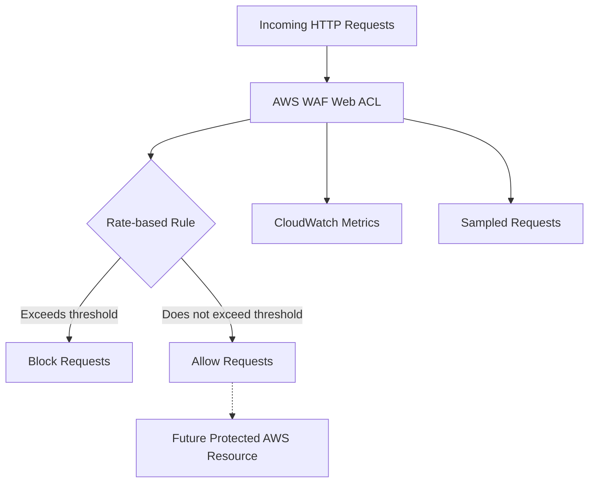
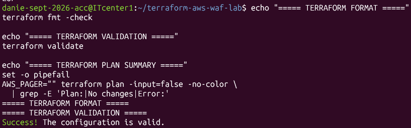

# AWS WAF Terraform Lab

## Project Overview

This project demonstrates how to design an AWS Web
Application Firewall (WAF) Web ACL using Terraform.

The configuration includes a rate-based security rule,
CloudWatch metrics, and sampled request monitoring.

**Deployment status: PLANNED ONLY — NOT DEPLOYED**

## Architecture



The application connection is a future integration.
No protected resource association is configured.

## Planned AWS Resources

| Resource | Count |
|---|---:|
| AWS WAF Web ACL | 1 |
| **Total** | **1** |

## Technical Configuration

- AWS Region: us-east-1
- Web ACL name: terraform-waf-lab
- Scope: REGIONAL
- Default action: ALLOW
- Rule name: rate-limit-rule
- Rule priority: 1
- Rate threshold: 100 requests
- Evaluation window: 300 seconds
- Aggregation: Source IP
- Matching rule action: BLOCK
- CloudWatch metrics: Enabled
- Sampled requests: Enabled

## Security Design

The rate-based rule monitors requests from individual
source IP addresses.

When the approximate request rate exceeds the
configured threshold, the rule blocks matching requests.

Requests not blocked by the rule are allowed.

CloudWatch metrics and request sampling are configured
to support monitoring.

## Security Limitations

- No Web ACL has been deployed.
- No protected AWS resource is associated.
- No real traffic has been inspected.
- No production rate-limit tuning has been performed.
- No AWS managed rule groups are configured.
- No dedicated WAF logging destination is configured.

The threshold of 100 requests per five minutes
is deliberately low for learning.

It may block legitimate traffic in production,
particularly users sharing a public IP address.

## Tools

- Ubuntu Linux (WSL2)
- AWS CLI
- Terraform
- Git and GitHub

## Terraform Validation

Commands:

```bash
terraform fmt -check
terraform validate
terraform plan -input=false -no-color
```

Verified results:

- Terraform formatting passed.
- Terraform validation passed.
- Plan: 1 to add, 0 to change, 0 to destroy.

See [Validation Evidence](docs/validation-evidence.md).

## Deployment Status

No terraform apply has been executed.

No AWS WAF resources have been deployed through
this Terraform project.

## Cost Considerations

AWS WAF can incur charges for Web ACLs, rules,
and inspected requests.

Review current AWS WAF pricing before deployment.

## Future Improvements

- Associate the Web ACL with an Application Load Balancer.
- Integrate with a supported API Gateway resource.
- Evaluate AWS managed rule groups.
- Configure WAF request logging.
- Tune rate limits using real traffic patterns.
- Test rule behavior in COUNT mode before blocking.

## Actual Validation Screenshot


