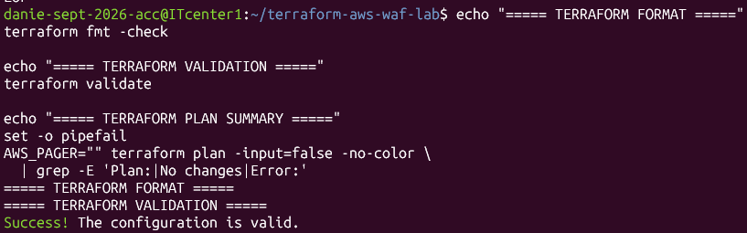

# AWS WAF Terraform Validation Evidence

## Status

PLANNED ONLY — NOT DEPLOYED

## Environment

- Ubuntu Linux (WSL2)
- Terraform v1.17.0
- AWS Region: us-east-1
- AWS CLI

## Verified Results

terraform fmt -check:
Passed.

terraform validate:
Success! The configuration is valid.

terraform plan:
Plan: 1 to add, 0 to change, 0 to destroy.

## Planned AWS Resources

1. AWS WAF Web ACL

## Security Configuration

- REGIONAL Web ACL
- Default action: ALLOW
- Rate-based rule: BLOCK
- Rate threshold: 100 requests per five minutes per IP
- CloudWatch metrics enabled
- Sampled requests enabled

## Security Limitations

- No AWS resource association
- No live traffic inspection
- No managed rule groups
- No dedicated WAF request logging
- No production rate-limit testing

## Deployment Status

No terraform apply executed.

No AWS WAF resources deployed through this project.

## Screenshot

The screenshot should show actual terminal validation results.
